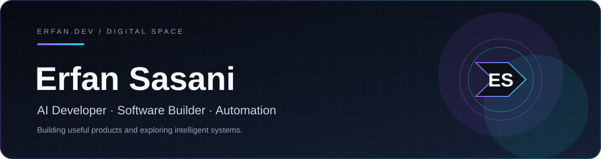

  

 

# Hey, I'm Erfan Sasani 👋

### AI Developer | Software Engineer | Automation Enthusiast

I build useful software products, explore AI-powered automation, and turn ambitious ideas into practical, scalable solutions.

My toolkit includes Python, Java, JavaScript, Node.js, and Nginx. I'm continuously growing my skills in AI engineering and intelligent systems.

 

### 🛠 Tech Stack

- **Languages:** Python, Java, JavaScript
- **Backend & Infrastructure:** Node.js, Nginx
- **Exploring:** AI Engineering, Workflow Automation, Intelligent Applications

### 🚀 What I'm Building

**01. Engineering Project Management Platform**

A comprehensive project management solution for architecture, civil engineering, and related industries.

*Private · In Development*

**02. Music Collaboration Platform**

A platform connecting composers, instrumentalists, musicians, and other creative professionals to collaborate on music projects.

*Private · In Development*

**03. Hamkar — Organizational Communication**

An internal communication platform aimed at improving collaboration within companies and organizations.

*Private · In Development*

### 🧠 What I'm Learning

I'm strengthening my skills in AI engineering, exploring intelligent automation, and developing scalable software applications.

### 🤝 Let's Connect

I'm open to freelance projects, product collaborations, and opportunities to build meaningful software.

- [LinkedIn](https://www.linkedin.com/in/erfan-sasani-655649208)
- [X / Twitter](https://x.com/twobeastsover)

---

*Keep learning. Keep building. Make ideas real.*

